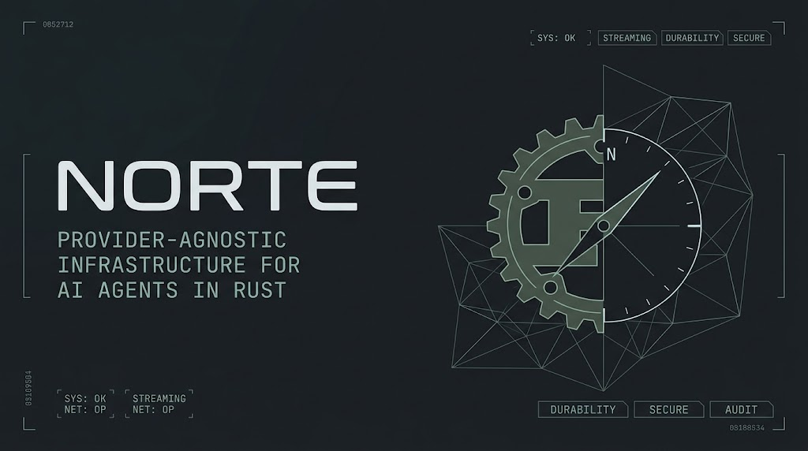

<p align="center">
  
</p>

# Norte

<p align="center">
  <a href="https://github.com/JeanVydes/Norte/actions/workflows/rust.yml"></a>
  <a href="https://github.com/JeanVydes/Norte/blob/dev/LICENSE"></a>
  
  
</p>

**Provider-agnostic model and tool APIs for Rust.** Norte provides a shared
message model, typed capabilities, provider adapters, streaming events, and
optional tool and media support. It does not create sessions, run an agent
loop, or persist conversation history; the application owns those policies.

## Crates

- **`norte`** is the facade with optional provider and helper features.
- **`norte-core`** defines messages, parts, model requests, streaming, tools,
  capabilities, and adapter contracts.
- **`norte-openai`**, **`norte-anthropic`**, and **`norte-gemini`** implement
  their respective provider APIs.
- **`norte-http`** provides the shared HTTP transport and vendor profile.
- **`norte-tools`**, **`norte-mcp`**, and **`norte-testing`** are opt-in helpers.

Norte has no model catalogue. Applications select model identifiers and declare
the capabilities they want to expose. OpenAI-compatible endpoints can use the
OpenAI adapter with a configured endpoint and authentication profile.

## Install

```toml
[dependencies]
norte = { version = "0.0.2", features = ["openai", "tools"] }
```

Provider features are `openai` (default), `anthropic`, and `gemini`. Optional
helpers include `tools`, `media`, `mcp`, and `testing`; `full` enables all
features. Each crate can also be used directly.

## Stream a model response

```rust,ignore
use futures_util::StreamExt;
use norte_core::{Message, Model, ModelRequest};

let request = ModelRequest::new(
    model.reference().clone(),
    vec![Message::user("What is a prompt cache?")],
);
let mut stream = model.stream(request).await?;

while let Some(event) = stream.next().await {
    handle_model_event(event?);
}
```

The host decides how to collect events, keep conversation history, dispatch
tools, retry calls, cancel work, and persist any application state.

## Documentation and development

- [Guide](https://jeanvydes.github.io/Norte/) — concepts and API usage.
- [Rustdoc](https://docs.rs/norte/) — generated crate reference.
- [`CONTRIBUTING.md`](CONTRIBUTING.md) — workspace layout and checks.
- [`CHANGELOG.md`](CHANGELOG.md) — release history.
- [`benchmarks/`](benchmarks/) — reproducible performance measurements.

```sh
cargo fmt --all -- --check
cargo clippy --workspace --all-targets -- -D warnings
cargo test --workspace
RUSTDOCFLAGS="-D warnings" cargo doc --workspace --no-deps --document-private-items
```

## License

MIT.
