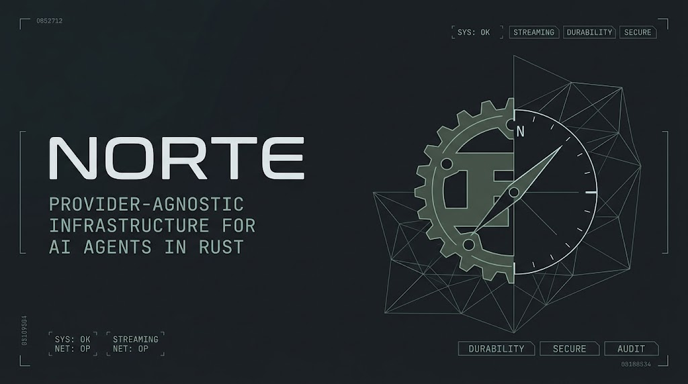

<p align="center">
  
</p>

# RustyChain

<p align="center">
  <a href="https://github.com/JeanVydes/rustychain/actions/workflows/rust.yml"></a>
  <a href="LICENSE"></a>
  
  
</p>

**Provider-agnostic infrastructure for LLM agents in Rust.** One core, three
first-class provider SDKs, and a streaming engine built to ship.

Write your agent once and run it on OpenAI, Anthropic or Gemini — or on any
OpenAI-compatible endpoint — without touching a line of application code. No
provider leaks into your application, and no model catalogue is baked in: you
declare what your models can do and the library does the rest.

## Why RustyChain

- **Provider-agnostic, for real.** Point the same agent at OpenAI, Anthropic or
  Gemini with a config change, not a rewrite.
- **Streaming from the first token.** Reasoning, answers, tool calls and media
  arrive live, never batched behind a finished response.
- **Durable by construction.** Every turn is an atomic commit. Sessions survive
  restarts, scale across workers and move between processes intact.
- **Lossless history.** Export a conversation and re-import it byte-for-byte —
  the provider cache prefix included.
- **Safe to hand it the keys.** Tool calls follow auditable policies, and an
  approval is bound to the exact arguments it was granted for.
- **Production-ready, not a demo.** Typed errors, retries, fuzzed parsers, no
  unsafe, pinned MSRV.

## Providers

| Provider | SDK | Compatibility |
| --- | --- | --- |
| OpenAI | `rustychain-openai` | 100% |
| Anthropic | `rustychain-anthropic` | 100% |
| Google Gemini | `rustychain-gemini` | 100% |

Measured against each provider's documented API — nothing is silently dropped.
OpenRouter, Groq, Together, vLLM and any other OpenAI-compatible endpoint work
through the OpenAI SDK with a different base URL.

## Install

Not published yet; depend on the repository:

```toml
[dependencies]
rustychain-core = { git = "https://github.com/JeanVydes/rustychain", branch = "dev" }
rustychain-openai = { git = "https://github.com/JeanVydes/rustychain", branch = "dev" }
```

## Quickstart

```rust
use std::sync::Arc;

use rustychain_core::{
    Capabilities, EngineBuilder, InMemoryBlobStore, InMemoryStore, Message, Modality, ToolRegistry,
};
use rustychain_openai::presets::openai;

#[tokio::main]
async fn main() -> Result<(), Box<dyn std::error::Error>> {
    let capabilities = Capabilities::builder()
        .input(Modality::Text)
        .output(Modality::Text)
        .build();
    let model = openai("gpt-5", std::env::var("OPENAI_API_KEY")?, capabilities)?;

    let engine = EngineBuilder::new()
        .store(Arc::new(InMemoryStore::new()))
        .blobs(Arc::new(InMemoryBlobStore::new()))
        .model(Arc::new(model))
        .tools(ToolRegistry::new())
        .build()?;

    let session = engine.create().await?;
    let outcome = engine.send(session.id, Message::user("Hello!")).finish().await?;
    println!("{}", outcome.message.as_ref().map(Message::text).unwrap_or_default());
    Ok(())
}
```

`Store` and `BlobStore` are ports. The in-memory pair above is ready to use and
implements the whole contract — one atomic commit per turn, optimistic
concurrency, the tool-approval ledger, content-addressed bytes. It is the right
default for a CLI, a desktop app, a prototype or a single-process worker; when a
session has to outlive the process, implement the two traits over your own
database and object storage. Nothing else in the engine touches infrastructure.

## Examples

Runnable, end-to-end programs live in [`examples/`](examples/):

- [`react-agent`](examples/react-agent) — a streaming ReAct agent on OpenRouter
  with live reasoning, an approval-gated shell tool, a custom fetch tool, and a
  two-model fan-out once the data is gathered.

## Documentation

Every crate carries module-level rustdoc (`cargo doc --workspace --no-deps
--open`), and [`CONTRIBUTING.md`](CONTRIBUTING.md) covers the layout, the build
and the lint policies. The behavioural spec lives beside the code as
`docs/SRS.md` and is deliberately not committed.

## Development

```sh
cargo fmt --all -- --check
cargo clippy --workspace --all-targets -- -D warnings
cargo test --workspace
RUSTDOCFLAGS="-D warnings" cargo doc --workspace --no-deps --document-private-items
```

Wire parsers are fuzzed with `cargo-fuzz` (`fuzz/`); live provider tests are
`#[ignore]`d.

## License

MIT.
